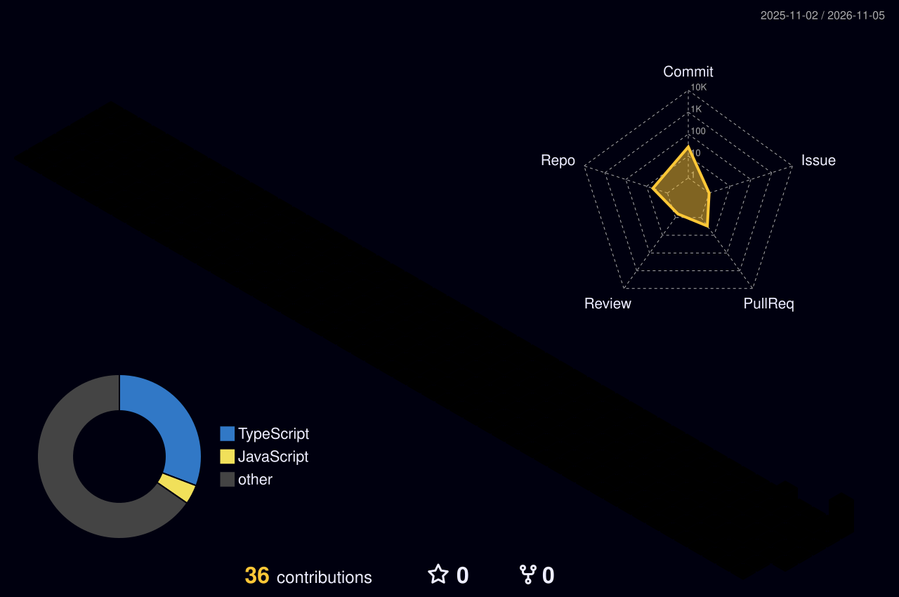

<div align="center">


<br>


<br><br>


<br>

**COMPUTER SCIENCE • SOFTWARE ENGINEERING • INNOVATION**

*Chennai, India*

</div>

---

## ✦ 001 / ABOUT ME

### Hello, I'm Sri Raman.

I'm a Computer Science and Engineering student at
**Vel Tech University, Chennai**.

I enjoy creating meaningful software,
exploring new technologies, and solving
real-world problems through engineering.

My interests include:

- Full-stack development
- Artificial Intelligence
- Software Engineering
- System Design
- Startup Innovation
- Open Source

> "I don't just want to write code.
> I want to build something that matters."

---

## ✦ 002 / MY TECHNOLOGY STACK

<div align="center">

### Languages


### Frontend Development


### Backend & Databases


### Tools & Platforms


</div>

---

## ✦ 003 / MY DEVELOPMENT PHILOSOPHY

<table>
<tr>
<td align="center" width="33%">

### 01

**EXPLORE**

Discover new ideas and technologies.

</td>
<td align="center" width="33%">

### 02

**ENGINEER**

Transform ideas into functional solutions.

</td>
<td align="center" width="33%">

### 03

**EVOLVE**

Continuously learn, improve, and innovate.

</td>
</tr>
</table>

---

## ✦ 004 / DEVELOPER STATUS

```yaml
developer:
  name: Sri Raman D N
  education: B.Tech CSE
  university: Vel Tech University
  location: Chennai, India

  current_focus:
    - Full Stack Development
    - Artificial Intelligence
    - Backend Engineering
    - Real World Applications

  status: Building and Learning
  mindset: Never Stop Improving
```

---

## ✦ 005 / GITHUB ANALYTICS

<div align="center">


<br><br>


</div>

---

## ✦ 006 / CONTRIBUTION ACTIVITY

<div align="center">


</div>

---

## ✦ 007 / ANIMATED CONTRIBUTION SNAKE

<div align="center">

<picture>
  <source media="(prefers-color-scheme: dark)" srcset="https://raw.githubusercontent.com/YOUR_USERNAME/YOUR_USERNAME/output/github-contribution-grid-snake-dark.svg"/>
  <source media="(prefers-color-scheme: light)" srcset="https://raw.githubusercontent.com/YOUR_USERNAME/YOUR_USERNAME/output/github-contribution-grid-snake.svg"/>
  
</picture>

</div>

---

## ✦ 008 / 3D CONTRIBUTION UNIVERSE

<div align="center">



</div>

---

## ✦ 009 / MY FUTURE ROADMAP

<div align="center">


</div>

---

## ✦ 010 / LET'S CONNECT

<div align="center">

### GREAT IDEAS DESERVE TO BE BUILT.

I'm interested in collaborating on
innovative software and meaningful projects.

<br>

[](https://github.com/YOUR_USERNAME)

<br><br>

**DESIGNED WITH INTENTION. BUILT WITH CURIOSITY.**

<sub>© 2026 SRI RAMAN D N</sub>

<br>


</div>
